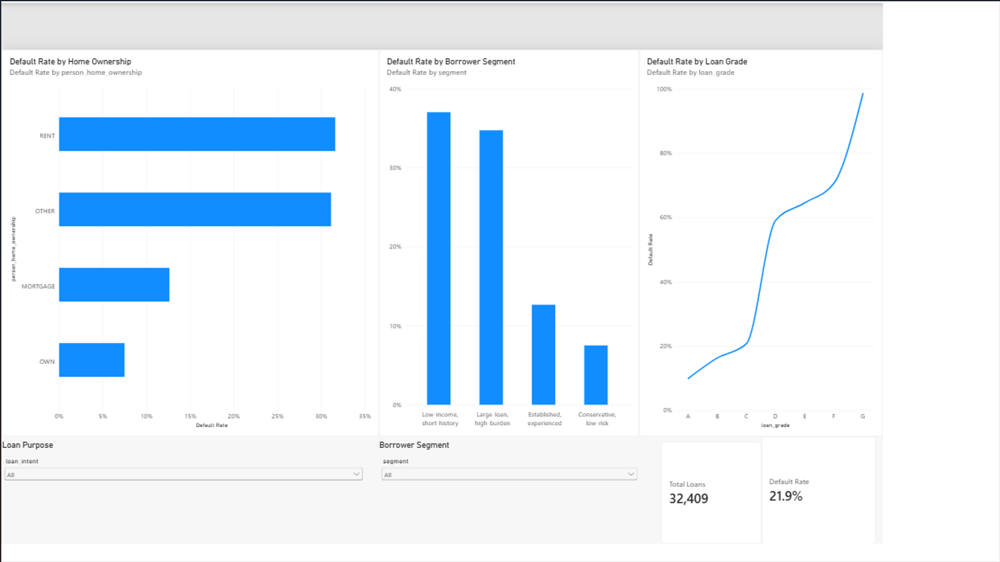

# Credit Risk Analysis and Prediction

## Dataset Content
The dataset is the [Credit Risk Dataset] https://www.kaggle.com/datasets/laotse/credit-risk-dataset from Kaggle. It contains 32,581 rows and 12 columns describing borrowers and their loans. 
## Business Requirements
1. To identify which borrower and loan characteristics are most associated with loan default. (e.g., income, loan size, loan-to-income, loan purpose, home ownership, credit history). 
2. To segment borrowers into distinct risk groups so the lender can see who high-risk and low-risk customers are.
3. To build a model that predicts the likelihood of default for a new applicant, and explain how well it performs and what its limits are. 
4. To present the findings in an interactive Power BI dashboard that a risk manager can filter and use. 

## Hypotheses
1. Borrowers with a higher loan-to-income ratio default more often.
2. Borrowers with prior default on file are more likely to default again.
3. Default rates differ by loan purpose and home ownership type.
4. A model that excludes loan grade and interest rate can still predict default well above a baseline. 

## Project Plan
1. Choose credit risk dataset from Kaggle 
2. Data cleaning (ETL) 
3. Exploratory Data Analysis - create visualisations 
4. Machine learning - Implement classification and clustering 
5. Dashboard - Build Power BI dashboard to present findings 
6. Check notebook and write README

## Analysis Techniques Used
Data cleaning (01):
- The raw file was kept untouched in data/raw, however a working copy was cleaned and adjusted. 
- The cleaned file dropped 165 duplicate rows, less than 1% of the data. 
- 5 rows with impossible ages (123 and 144) and 2 rows with employment lengths of 123 years were also removed as data entry errors.
- Missing values in columns 'person_emp_length' (895) and 'loan_int_rate' (3116), were filled with the median for their repective columns. However, flag columns were added, so the adjusted rows were identifiable, 'emp_length_missing', 'int_rate_missing'. 
- Cleaning resulted in 32,409 rows and 14 columns, saved in 'processed' within data folder. 

Exploratory Data Analysis (02):
- Determined from value_counts 78.1% of loans defaulted and 21.9% did not.
- Grouped aggregation showed 37.9% of borrowers who had a previous default, defaulted again, compared to 18.4% who did not. 
- Defaulted loans had a higher loan-to-income ratio 
- When looking at loan intent, the heatmap showed that debt consolidation (28.7%), mediacal (26.8%) and home improvement (26.2%) default the most, with venture (14.9%) and education (17.3%) the least. 
- When looking at homeownership type, 31.6% of renters defaulted, compared with 12.6% of mortgage holders and 7.5% of owners. The 'other' group was 31.1% but only contained 106 loans so was not interpreted. 
- When looking at loan grade, default rates climb from 10% at (A) to 20.8% at (C), jumping to 59.0% at (D), reaching 98.4% at G, which only had 64 loans. 
- When considering the missing values in the dataset, 31.7% of borrowers with a missing employment length defaulted, compared to 21.6% of those with a recorded value, highliting the value associated with employment length. However, a missing interest rate made almost no difference (20.7% missing value and 22.0% recorded value)  
- With reference to correlation, loan-to-income ratio (+0.38) and interest rate (+0.32), correlate most positively with default. 

Limitations:
- Using the median for missing interest rates create a spike in some charts. 
- Conclusive findings only show association and do not show causation.  
- Models are based of a single train/test split. 

## Machine Learning Approach
Modelling and Machine Learning (03):
- Models were trained on a 80/20 stratified split 
- A baseline ws produced aswell as a random forest with all 24 features and a random forest without loan grade and interest rate. 
- Without loan grade and interest rate, the model was still able to identify 62% of defaulters, whereas the baslien identified none. 
- With clustering, Kmeans with 4 clusters on 6 borrower and loan features, without loan status. Income was log-transformed first. The silhouette scores were low between 0.15 and 0.21, meaning the segments overlapped, however the default rates still heavily differed. 
- The two highest risk segments (large loan, high burden) and (low-income, short history) held almost 50% of borrowers but around 78% of defaults combined. 

## Dashboard Design
Dashboard (Power BI) (04):
- The Power BI dashboard (dashboard/credit_risk_dashboard.pbix), shows total loans and the overall default rate, default rate by borrower segment, loan grade and home ownership and slicers for loan purpose and segment. 

## Ethical Considerations
- The dataset contains no names, with no risk of identifying a real person
- The models use person_age as features. Age is a protected characteristic in many areas including the UK. A model using this could disadvantage a group within a certain age without intending to. 
- Features such loan_grade and loan_int_rate have been given a rating by someone else, meaning they have undergone a lenders risk assessment. Using a lenders data, leaves the models succesptible to repeating the lenders biases. This is a reason a second model without these features was tested. 
## Development Roadmap
Challenges:
- About 12.5% of the dataset had missing values, which was considered as too many to remove as it could heavily influence any models and conculsions made. Instead they were filled with median, with flag columns added first. The EDA then showed that employment length flag carried much information whereas interest rate flag did not. 
- Only about 22% of loans defaulted, so any models that predicted no default scored 78% accuracy. A baseline was built to show this problem, using stratified train/test split.
## Main Data Analysis Libraries
- Pandas
- NumPy
- Matplotlib
- Seaborn 
- scikit-learn 
- Power BI Desktop 
- Git and Gitbhub 
- os 
## Credits
Dataset:
Kaggle
 - https://www.kaggle.com/datasets/laotse/credit-risk-dataset 
Code:
Claude AI (Anthropic) was used for guidance and code creation. 
- Assisted with modelling in the stratified train/test split
- Was used for classification, clustering, log transform of income 'Standardscaler' and the elbow and silhouette loop. 
- Was used for advice and guidance on building Power BI dashboard. 
- Was used for subheadings and titles. 

Lms.codeinstitute.net (Advanced Data Analysis Libaries) was used for code.  
- Was used for code using seaborn and matplotlib visualisations 

